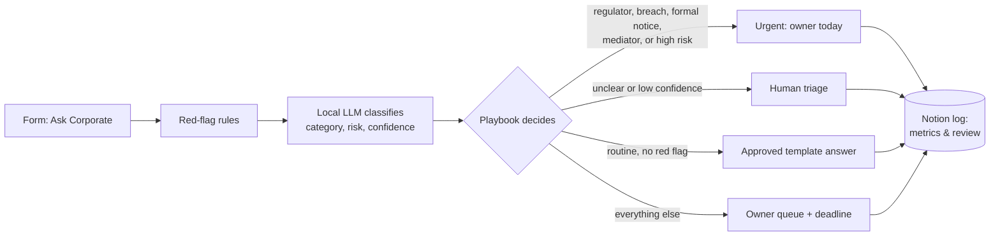

# Legal front door

**One simple way for every team to get what they need from Legal, Privacy and Compliance, built with n8n, a local LLM and Notion.**

Routine questions get an instant answer from an approved playbook. Everything else reaches the right owner with a deadline. Urgent matters (a regulator, a data breach, a formal notice, a mediator) are escalated the same day, whatever the AI thinks. Every request is logged, so the team can measure adoption, quality and speed.

> Demo built for a **fictional health insurer**. The policies, owners and deadlines in `playbook.json` are invented, and all test requests are synthetic. No real personal data is used.

**▶ [Watch the 2-minute demo](PASTE_LOOM_LINK)**


| Result on 40 test requests | Local model (qwen2.5:7b) |
|---|---|
| Requests routed correctly | 95% |
| Urgent cases escalated | 6/6 (the model alone would have caught 4) |
| Template answers sent where an expert was needed | 0 |

---

## The problem

In a growing regulated company, the Corporate team (legal, privacy, compliance, governance, security) gets requests through Slack DMs, emails and hallway questions. That creates three problems:

1. **Nobody sees the full picture.** Requests are scattered, so there's no way to know volumes, owners or delays.
2. **Experts spend time on repeat questions.** "Can I use the standard NDA?" or "Who signs a €80k contract?" have written answers that already exist.
3. **Urgent matters can sit in the wrong inbox.** A member threatening to go to the mediator, or an email sent to the wrong person, has a legal clock running from the moment someone knows about it.

## What it does



1. **Intake.** An n8n form collects the request, the team and an optional deadline.
2. **Red-flag rules.** Deterministic checks (FR and EN) look for a regulator (ACPR, CNIL...), a formal notice or legal action, a mediator, a possible data breach, or health data shared outside the company. They run before the AI and can only raise the risk level.
3. **Classification.** A local model (Qwen 2.5 7B on Ollama) returns a category, a risk level, whether an expert is needed, a confidence score and a one-line summary, as structured JSON constrained to the playbook's categories.
4. **Decision.** Plain code applies the playbook: urgent, human triage, template answer or owner queue, with an owner and a deadline in business days. Notes like the GDPR 72-hour breach notification window or the one-month deadline for data subject requests are added automatically.
5. **Logging.** Every request is written to a Notion database with its route, owner, deadline, red flags and model confidence.

## Design choices

These choices matter more than the model:

- **The AI classifies; it never writes legal answers.** Instant answers come from templates the legal team approved (`playbook.json`). The model only decides which box a request goes in, so it can't invent legal advice.
- **Controls before AI.** Red-flag rules escalate regardless of the model's opinion. The evaluation measures what the model would miss without them.
- **Fail safe, not fail silent.** Malformed output, an unknown category, low confidence or an unreachable model all send the request to a human. Nothing gets auto-answered by accident.
- **Local model.** Requests can contain health or employee data, so nothing leaves the machine. The trade-off is speed (about 20 seconds per request on a laptop) and a weaker grasp of categories than a large cloud model, which the guardrails above are designed to absorb (see the results below).
- **One source of truth.** Categories, owners, deadlines, rules and answers all live in `playbook.json`. The legal team updates the playbook, and `scripts/build_workflow.py` regenerates the n8n workflow from it.

## Measuring it

### Offline evaluation

`eval/run_eval.js` runs 40 labelled synthetic requests (French and English, covering every category plus vague and non-legal ones) through **the same code as the workflow** and the same local model.

The same 40 requests were also run through a cloud model (Mistral Large, on synthetic data only) to answer a real deployment question: how much does keeping data on the machine cost, and do the guardrails close the gap where it matters? Each run is saved with every miss listed: [local](eval/results-qwen2.5-7b.md), [cloud](eval/results-mistral-large-latest.md).

| Run of 4 Nov 2026 | Local: qwen2.5:7b | Cloud: mistral-large-latest |
|---|---|---|
| Route accuracy | 95% | 88% |
| Category accuracy | 93% | 100% |
| Urgent requests caught (rules on / model alone) | 6/6 / 4/6 | 6/6 / 6/6 |
| Unsafe auto-answers | 0 | 0 |
| Median time per request | 20.6 s | 1.7 s |

The two numbers that matter most are **urgent requests caught** (target: all of them) and **unsafe auto-answers** (target: zero). Both models hit both targets.

**What the comparison shows.** The cloud model understood every request (100% of categories) and caught all urgent cases without help, but it routed less well, because it was more cautious than the playbook: it sent standard questions to experts and escalated two non-urgent ones as urgent. The local model misread a few categories, and the red-flag rules caught the two urgent cases it missed. All misses, in both runs, sent a request to a human rather than giving a wrong answer.

My conclusion: the guardrails, not the model size, keep the system safe. The remaining errors are about calibrating "needs an expert" and "urgent", which is a policy decision for the legal team to make in the playbook. Over-escalation also has a cost, because an urgent label that fires too often stops being trusted. For health-related requests I would keep the local model, or use a cloud model only under an EU hosting and data processing agreement.

### In production

The Notion database is built to answer the four questions a Corporate team would ask:

| Question | Measured with |
|---|---|
| **Adoption:** are teams using it? | Requests per week and per team; share of requests arriving through the front door rather than by DM |
| **Quality:** is routing right? | Owners mark each request *Correct* or *Wrong route* in the `Route check` column; red-flag hits on urgent cases |
| **Efficiency:** is it faster? | Auto-answer rate; time from `Received` to `First response`; share of requests answered before `SLA due` |
| **Improvement:** what do we fix next? | A weekly look at *Wrong route* and *Human triage* items: each one becomes a playbook update, a new rule or a new template |

## Limits and next steps

- The test set is synthetic and small (40 requests). The real test is a few weeks with real users and the owners' route checks.
- Confidence scores from a small local model are not well calibrated, which is why the threshold only sends requests to a human and never auto-answers.
- About 20 seconds per request on a laptop is acceptable for an intake form but not ideal. A production version would confirm receipt instantly and send the answer by email or Slack.
- Next steps: sharpen the `template_request` and `ai_use` definitions (two of the local model's three misses), Slack intake and owner notifications, reminders before `SLA due`, and a weekly metrics digest.

---

## Run it yourself (about 20 minutes)

Tested with n8n 2.35.7.

**You need:** Docker, [Ollama](https://ollama.com), Node 18+, Python 3, a Notion account.

1. **Model:** `ollama pull qwen2.5:7b`, then make sure Ollama is running. On a machine with 8 GB of RAM, use `qwen2.5:3b`.
2. **n8n:** use your existing n8n, or run `docker compose up -d` **from this folder** and open http://localhost:5678.
3. **Notion:**
   - Create an internal integration at notion.so/profile/integrations and copy its secret.
   - Create an empty page and add the integration under "..." > Connections.
   - Run `NOTION_TOKEN=ntn_... python3 scripts/setup_notion.py "<page link>"`. It creates the database and prints its ID.
4. **Workflow:**
   - In n8n, import `n8n/legal-front-door.workflow.json`.
   - In the **Config** node, paste the database ID (and change the model name if you use another one). Keep `ollamaUrl` as `http://host.docker.internal:11434` if n8n runs in Docker; use `http://localhost:11434` if n8n runs directly on your machine.
   - In **Log to Notion**, create a Notion credential with the same secret.
5. **Try it:** publish (activate) the workflow and open the form URL from the **Legal request form** node.
6. **Evaluate:**
   - Local model: `node eval/run_eval.js` (add `--model qwen2.5:3b` to try another one).
   - Cloud comparison: `MISTRAL_API_KEY=... node eval/run_eval.js --provider mistral`. A full run is 40 short requests, so it costs cents.

**Troubleshooting:** if n8n can't reach Ollama on Linux, start Ollama with `OLLAMA_HOST=0.0.0.0 ollama serve`.

### Changing the playbook

Edit `playbook.json` or `prompts/classify_system.md`, then:

```
python3 scripts/build_workflow.py   # regenerate the workflow
node scripts/test_nodes.js          # 11 checks on routing and safety rules
node eval/run_eval.js               # re-measure
```

and re-import the workflow in n8n.

## Repository

```
playbook.json                 categories, owners, deadlines, red-flag rules, approved answers
prompts/classify_system.md    instructions for the classifier
n8n/src/                      routing logic used by the workflow and the evaluation
n8n/legal-front-door.workflow.json   generated, importable n8n workflow
eval/dataset.jsonl            40 labelled synthetic requests
eval/run_eval.js              evaluation → eval/results-<model>.md
scripts/                      build, tests, Notion setup
```

Built by [Charalampos Kapsoulis](https://charalamposkapsoulis.com), M1 digital law student at the Université de Caen.
